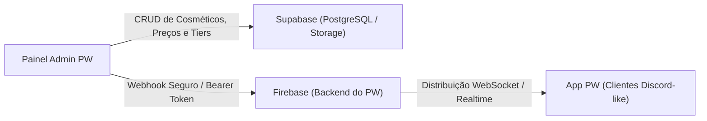

# PW Loja & Painel Administrativo (Discord Style) 🛍️✨

Painel administrativo independente e moderno, desenvolvido especialmente para gerenciar a **Loja Oficial do PW** (plataforma similar ao Discord), com suporte a cosméticos de perfil, assinaturas estilo Nitro, pacotes de moedas e controle de inventário de usuários.

---

## 🚀 Tecnologias & Arquitetura

- **Frontend / Backoffice:** Next.js 16 (App Router), React 19, TypeScript, Tailwind CSS.
- **Tema:** Discord Dark Theme autêntico (`#313338`, `#2b2d31`, `#1e1f22`, Discord Blurple `#5865F2`).
- **Banco de Dados & Storage:** **Supabase** (PostgreSQL, Storage Buckets para imagens/efeitos/animações, e Row Level Security).
- **Servidor Backend do PW:** **Firebase** (Cloud Functions ou Realtime/Firestore sincronizados via Webhook seguro com token de autenticação).



---

## 🎨 Tipos de Produtos Completos

1. **🎭 Molduras de Avatar (Avatar Decorations):**
   - Suporte a animações em WebP, APNG, Lottie ou GIFs.
   - Efeitos visuais dinâmicos (Chamas, Brilho Neon, Sakuras, Relâmpagos).
   - Teste ao vivo em tempo real sobre o avatar do perfil.
2. **✨ Efeitos de Perfil (Profile Effects):**
   - Efeitos visuais animados que são exibidos quando o perfil é inspecionado.
   - Banners temáticos com sobreposições luminosas.
3. **🏷️ Insígnias de Perfil (Badges):**
   - Conquistas, apoiadores alfa, moderadores, desenvolvedores e selos de eventos.
4. **🎨 Nameplates / Estilos de Nome:**
   - Gradientes de cor no nome do usuário (RGB, Holográfico, Ouro 24K, Cyberpunk).
5. **👑 Planos de Assinatura (Estilo Discord Nitro):**
   - *PW Nitro Basic*, *PW Nitro Booster*, *PW Nitro Ultimate*.
   - Configuração de limites de upload, boosts de servidor, bônus mensal de moedas e descontos na loja.
6. **🪙 Pacotes de Moedas Virtuais (PW Coins):**
   - Pacotes de moedas virtuais com bônus percentuais para compras na loja.
7. **🎁 Bundles / Coleções Promocionais:**
   - Pacotes combinando múltiplos cosméticos com desconto.

---

## 📦 Como Rodar o Projeto Localmente

1. **Instalar as dependências:**
   ```bash
   npm install
   ```

2. **Configurar as Variáveis de Ambiente:**
   Copie `.env.example` para `.env.local` e preencha suas credenciais:
   ```env
   NEXT_PUBLIC_SUPABASE_URL=https://seu-projeto.supabase.co
   NEXT_PUBLIC_SUPABASE_ANON_KEY=sua-anon-key-aqui
   SUPABASE_SERVICE_ROLE_KEY=sua-service-role-key-aqui
   FIREBASE_PW_WEBHOOK_URL=https://us-central1-seu-projeto.cloudfunctions.net/onShopSync
   PW_SYNC_SECRET=pw_super_secret_token_2026
   ```

3. **Executar em modo de desenvolvimento:**
   ```bash
   npm run dev
   ```
   Acesse: [http://localhost:3000](http://localhost:3000)

4. **Compilar para produção:**
   ```bash
   npm run build
   npm run start
   ```

---

## 🗄️ Configuração do Banco de Dados no Supabase

1. Acesse o painel do seu projeto no **Supabase** ([supabase.com/dashboard](https://supabase.com/dashboard)).
2. Vá até o menu lateral esquerdo em **SQL Editor**.
3. Abra e execute o arquivo `supabase/schema.sql` para criar todas as tabelas, índices e políticas de segurança RLS.
4. *(Opcional)* Execute o arquivo `supabase/seed.sql` para popular o catálogo com cosméticos prontos estilo Discord Shop.

---

## ⚡ Conexão com o Servidor Firebase do PW

Quando um produto é criado, editado ou concedido a um usuário no Painel Admin, um webhook HTTP `POST` é disparado automaticamente para o `FIREBASE_PW_WEBHOOK_URL` com o seguinte payload:

```json
{
  "action": "ITEM_CREATED",
  "timestamp": "2026-11-17T12:00:00.000Z",
  "targetId": "uuid-do-item",
  "data": {
    "title": "Katana Cyberpunk Neon",
    "category": "avatar_decoration",
    "priceBRL": 24.90,
    "priceCoins": 750
  },
  "secret": "pw_super_secret_token_2026"
}
```

O servidor Firebase pode simplesmente invalidar o cache local ou emitir um evento via WebSocket para que todos os clientes do PW atualizem o catálogo da loja instantaneamente!
